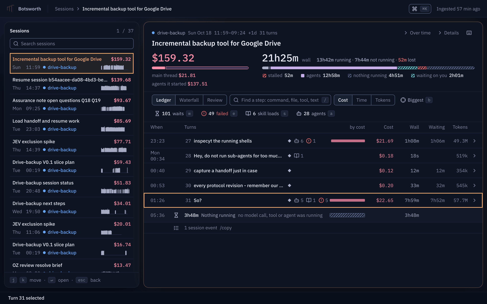
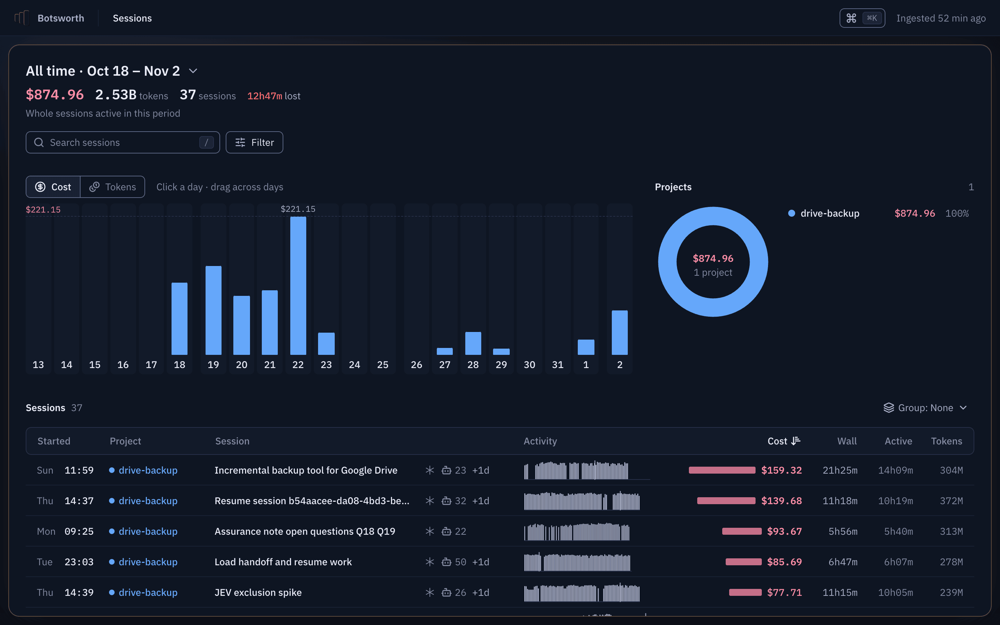
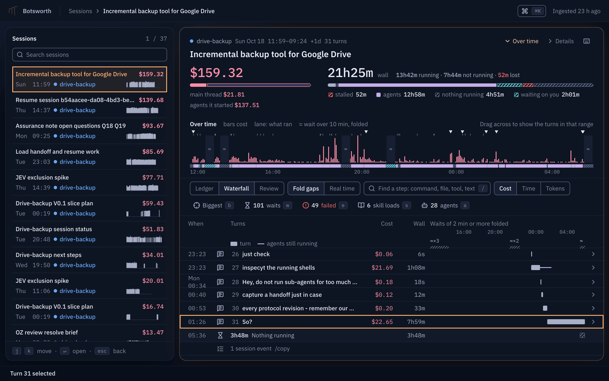
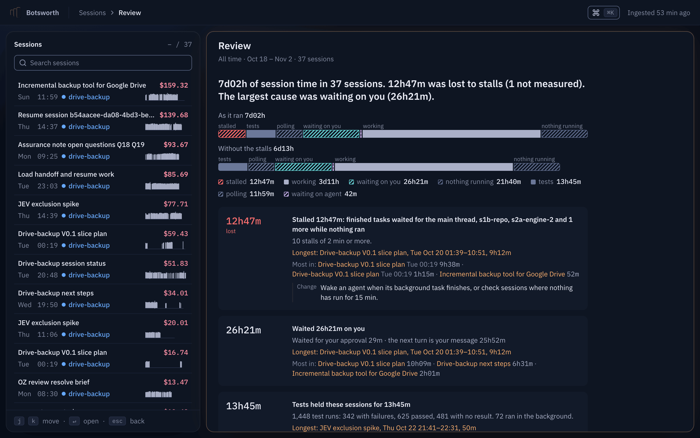
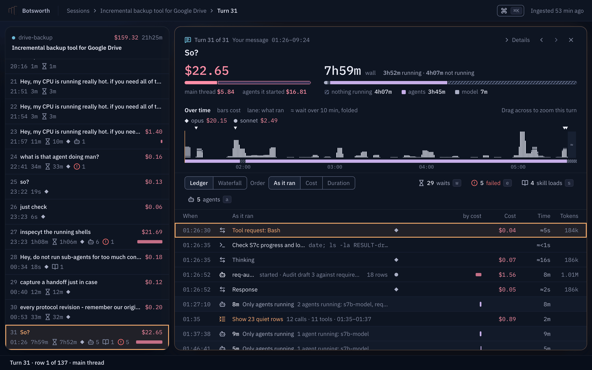
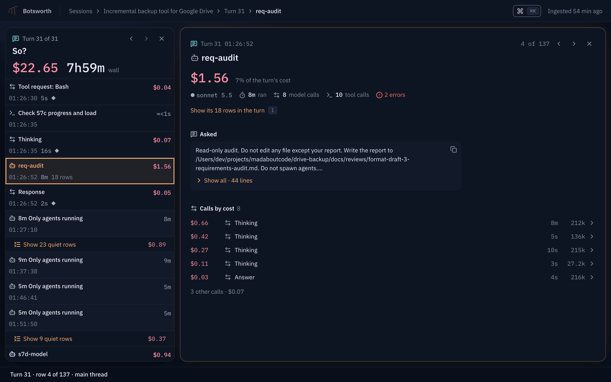
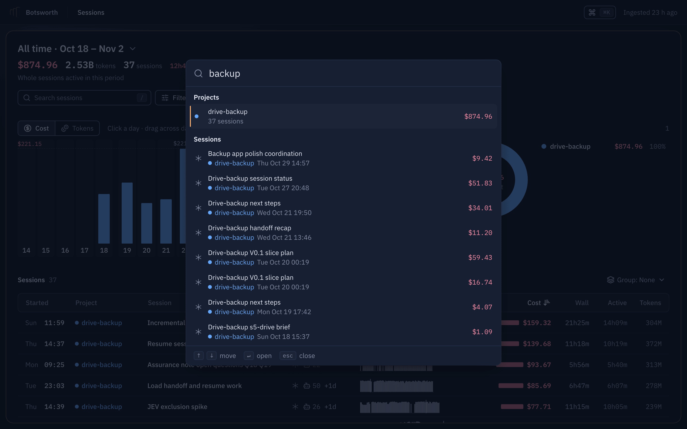
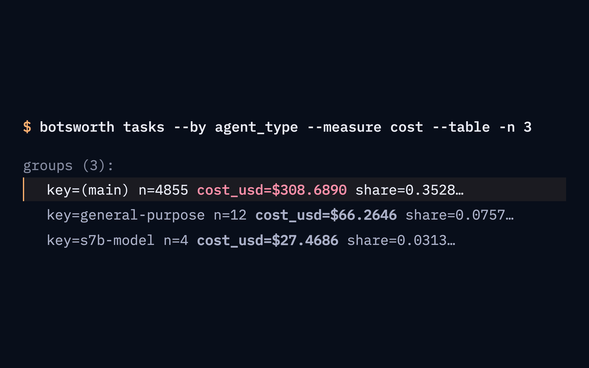

# Botsworth

[](https://github.com/singularityhq/botsworth/actions/workflows/ci.yml)
[](LICENSE)


**Botsworth shows where the time, tokens and money of your coding-agent sessions went.** It reads the logs that
Claude Code, Codex and omp already write, keeps the numbers in a local SQLite file, and gives you a web UI and a
command line over them. Nothing leaves your machine ([Privacy](#privacy)).



▶ **[Watch the 76-second video](https://github.com/singularityhq/botsworth/raw/main/docs/media/botsworth-promo.mp4)** (MP4, 8 MB) · [Install](#install) · [Features](#features) ·
[Command line](#command-line) · [How the numbers are counted](#how-the-numbers-are-counted)

## What one real project showed

Every picture on this page comes from one real project, renamed `drive-backup` and scrubbed: 37 Claude Code
sessions over 16 days, $874.96. Botsworth turned those logs into three things worth changing:

- **Sub-agents carried 65% of the cost.** The main threads cost $308.69; the agents they started cost the rest.
- **In the costliest session, the model worked 40 minutes of 21 hours.** Sub-agents ran for almost 13 hours, and the
  session waited 2 hours on its user.
- **Waiting and failing took more time than working.** Across all sessions: 26h21m waiting on the user, 12h47m
  stalled (a finished task waited for an agent that was not running), and 342 of 1,448 test runs failed.

Your numbers will differ. The point is that you can see them.

## Features

### Sessions: what a period cost, and which sessions caused it

The period total leads: cost, tokens, sessions, time lost to stalls. A chart shows cost per day, a ring shows cost
per project, and the list ranks sessions by cost, wall time, active time or tokens. Pick any period, drag across
days, or filter by provider, model, branch or project.



### Session: where one session's money and time went

The header splits the cost into the main thread and the agents it started, and the wall time into model, tools,
agents, waiting on you, nothing running and stalled. Every turn has a cost bar, so the expensive ones stand out;
press `b` (Biggest) to jump to the costliest. Chips count waits, failed tool calls, skill loads and agents, and each
has a key to step through them.


### Over time and Waterfall: when it happened

Over time draws the session's cost as bars along its whole length, with a lane underneath for what was running
(model, agents, waiting on you, nothing) and long waits folded; drag across it to list the turns in that range.
The Waterfall lays each turn on the same time axis, so a turn that ran for hours while its agents worked stands out
next to the ones that took seconds.



### Review: what wasted time, and what to change

Review explains the time of every session in scope in one sentence, then lists the causes, largest first: stalls,
waiting on you, tests, polling. Each finding names the sessions where it happened most and suggests a change.



### Turn and Detail: what an expensive turn actually did

A turn lists every model call, tool call and agent run in order, with cost, time and tokens, and can be reordered
by cost or duration. Open any row for its detail: model, tokens (including cache reads and writes), cost, timing,
the calls it made, and the original text, read from your log file only when you open it.





### Search

Press `⌘K` (or `Ctrl+K`) to find any session or project by name.



### Command line: the same answers for scripts and agents

Every view has a command behind it. Commands print JSON by default, so your scripts and your agents can ask
Botsworth the same questions.



## Install

You need Python 3.12 or newer and [uv](https://docs.astral.sh/uv/). Building from source also needs Node 24 or
newer and `make`.

From source, which is the only way until the first PyPI release:

```sh
git clone https://github.com/singularityhq/botsworth
cd botsworth
make setup                          # npm ci and UI build, then uv sync
make build                          # builds the UI and the wheel into dist/
uv tool install dist/botsworth-*.whl
```

On a laptop this takes about half a minute. After the first PyPI release it becomes `uv tool install botsworth`.

## Quick start

```sh
botsworth paths                     # where the store lives; creates nothing
botsworth ingest                    # read your provider logs into the store
botsworth serve --open              # UI and API on http://127.0.0.1:8420
```

Nothing ingests on its own. Run `botsworth ingest` again to pick up new sessions; only logs that changed are read
again. `--provider claude_code` (repeatable; also `codex`, `omp`) reads only some providers. `botsworth ingest
--rebuild` builds a new store from the logs and replaces the old one when it is done; a running `serve` keeps
working. It reads every provider, so it cannot be combined with `--provider`.

The UI opens on the last 7 days. To find your most expensive sessions, choose "All time" in the period picker and
click the Cost column.

If none of the provider folders exist, ingest still succeeds. It prints one JSON object, and each provider in it
reports `"discovered":0` and `"skipped":"root missing"`. `botsworth sessions --table` then shows `total: 0`. Check
the folder names under [Supported providers](#supported-providers).

## Command line

Every read command prints JSON by default. Add `--table` for key=value lines meant for reading, not for parsing.
`botsworth --help` lists all 30 commands, and `botsworth <command> --help` lists the options of one. Global options
such as `--db` go before the command: `botsworth --db PATH slow`. The examples below ran against the demo store;
`…` marks text cut for this page.

| Question | Command |
|---|---|
| Where did the time of this period go? | `botsworth slow --since 7d --table` |
| Which sessions cost the most? | `botsworth sessions --sort cost --table` |
| Where did one session's time go? | `botsworth breakdown <session> --table` |
| Which turns of a session cost the most? | `botsworth top --scope <session-id> --kind turn --metric cost_usd --table` |
| Which sub-agents, tools, skills or slash commands cost the most? | `botsworth tasks --by agent_type --measure cost --table` |
| What did one turn or call do? | `botsworth turn <turn-id>`, `botsworth detail <id>`, `botsworth source <id>` |

Where did the time go? `slow` starts with the causes, largest first:

```sh
botsworth slow --table
```

```text
review: wall 7d 2h, lost 12h 46m, 37 sessions (1 without stall data)
  stalled lost 12h 46m n=10 longest 9h 12m at 2026-10-20T01:39:31+05:30 T2
  you 1d 2h n=48 longest 9h 12m at 2026-10-20T01:39:34+05:30 T2
  tests 13h 45m n=1448 longest 49m 41s at 2026-10-22T21:41:55+05:30 T7
  polling 11h 58m n=573 longest 52m 24s at 2026-10-18T17:03:55+05:30 T9
  message 41m 31s n=1 longest 39m 24s at 2026-10-22T22:44:16+05:30 T12
…
```

(The UI shows 12h47m for the same stalls: the UI rounds to the minute, and the CLI's `_h` fields drop the seconds.)

Which turns of the costliest session cost the most? `--scope` takes the session id as `sessions` prints it:

```sh
botsworth top --scope claude_code/fe22d938-c9f5-4a89-ad82-53903be8584d/session/- --kind turn --metric cost_usd -n 3 --table
```

```text
total  cost_usd=$159.3186
claude_code/fe22d938-c9f5-4a89-ad82-53903be8584d/turn/main#36  turn  So?  cost_usd=$22.6461
claude_code/fe22d938-c9f5-4a89-ad82-53903be8584d/turn/main#32  turn  inspecyt the running shells  cost_usd=$21.6875
claude_code/fe22d938-c9f5-4a89-ad82-53903be8584d/turn/main#25  turn  /compact  cost_usd=$20.6256
```

Pass a printed id to `botsworth turn` or `botsworth detail`; `--kind llm_call` ranks model calls instead.

Who spent the money? `tasks` groups cost, tokens or time by a key. `(main)` is the main thread; everything else is
sub-agent work:

```sh
botsworth tasks --by agent_type --measure cost --table -n 3
```

```text
…
scope_totals: tok_total=2528668007 cost.cost_usd=$874.9610 cost.cost_lower_bound=False cost.n_unpriced=0 dur_ms_h=7d 2h
groups (3):
  key=(main) n=4855 n_sessions=36 … cost_usd=$308.6890 … share=0.35280319703206414 …
  key=general-purpose n=12 n_sessions=1 … cost_usd=$66.2646 … share=0.07573437935083746 …
  key=s7b-model n=4 n_sessions=1 … cost_usd=$27.4686 … share=0.031394 …
```

The same command with `--by slash` shows `/compact` at $129.42 over 12 turns (15% of the period). Other keys for
`--by`: `tool`, `skill`, `command_key`, `command_class`, `verb`. `--measure` is `tokens`, `cost`, `time` or `count`.

### Filters

`sessions`, `period`, `slow` and `tasks` take the same filters: `--from`/`--to` (days) or `--since 7d`, `--tz`,
`--provider`, `--model`, `--branch`, `--project`, `--q` and `--automated`. `breakdown` takes only `--tz` and `-n`;
it works on one session, so it needs no filter. `botsworth <command> --help` shows what each command accepts.

### Custom queries

`botsworth query` runs a query written as JSON, from an argument or from standard input (`-`). This one groups the
cost of every model call by model:

```sh
echo '{"scope":{"all":true},"select":"descendants","where":[{"field":"kind","in":["llm_call"]}],"measure":"own","metrics":["cost_usd"],"group_by":["model"],"limit":3}' | botsworth query - --table
```

```text
total  cost_usd=$874.9610
model=claude-opus-5-5  cost_usd=$482.9494  n=6438
model=claude-sonnet-5-5  cost_usd=$314.6506  n=7467
model=claude-fable-5-1  cost_usd=$74.5851  n=149
```

The default `measure` is `incl` (inclusive): a session's figure includes everything under it. Adding the figures of
a session and its descendants counts the same money several times. Use `"measure":"own"` when you sum across levels.

## How the numbers are counted

- **Cost** is the logged token counts multiplied by a price list. The list is a snapshot of
  [models.dev](https://models.dev) dated 2026-10-12, bundled in the package. It is not what your provider billed you;
  discounts, plans and rounding on the provider's side are not in it.
- **Once per API request.** One request can span several log lines. Cost and tokens are counted once for each
  request, not once for each line.
- **Unpriced models give a lower bound.** If a model has no price in the list, its calls count as unpriced. The cost
  is then shown as a lower bound (`cost_lower_bound` in JSON) together with the number of unpriced calls
  (`n_unpriced`).
- **Inclusive and own.** Inclusive cost of a session or turn contains its sub-agents. Own cost is only what that item
  did itself.
- **Time** is wall time from the first to the last record of a session. Each moment of it falls in the first
  matching category: *model working*; *tools running* (tests and sleeps are marked inside it); *only agents
  running* (sub-agents or background commands); *waiting on you* (a question or permission prompt, or the gap before
  your next message); *waiting for an agent's message*; *usage limit* (inferred); and *nothing running*, which
  includes *stalled* (a finished task waits for an agent that is not running). The parts add up to the wall time.
  Time for Claude Code is taken from log record times, so it is approximate.

The exact rules are in [`docs/specs/interfaces.md`](docs/specs/interfaces.md) and
[`docs/specs/data-model.md`](docs/specs/data-model.md).

## Privacy

- Everything stays on your machine. `serve` listens on `127.0.0.1` unless you pass `--host`.
- Provider log folders are opened read-only. Botsworth never writes to them.
- The store keeps numbers (tokens, cost, times), names, and short previews of at most 160 characters. It does not
  store prompts, model output, thinking, or tool input and output. When you open a detail in the UI or run
  `botsworth source`, the text is read from your original log file at that moment. If you delete or move the log
  file, that text is gone from Botsworth too.
- The only network call in the code is `botsworth.pricing.snapshot.fetch`, which downloads the model price list from
  `https://models.dev/api.json`. It is a maintainer task, run by hand from a checkout with
  `uv run python -m botsworth.pricing.snapshot`. It writes one file, `models.dev-<date>.json`, into
  `src/botsworth/pricing/data/` (add a date tag as an argument to name the file; `--help` shows usage and calls
  nothing). Nothing else ever calls the network: ingest, serve and every query never call it.

## Where data lives

`botsworth paths` prints the exact folder. Defaults, from the platform app-data folder:

| OS | Data folder |
|---|---|
| macOS | `~/Library/Application Support/botsworth/` |
| Linux | `$XDG_DATA_HOME/botsworth/`, else `~/.local/share/botsworth/` |
| Windows | `%LOCALAPPDATA%\botsworth\` |

Windows is not tested yet.

The folder holds `botsworth.sqlite` and SQLite's own `-wal`, `-shm` and `.lock` files, nothing else. Ingest writes no
other files. To use another location, pass `--db PATH` to any command, or set `BOTSWORTH_DB` (the store file) or
`BOTSWORTH_HOME` (the folder). Order: `--db`, then `BOTSWORTH_DB`, then `BOTSWORTH_HOME`, then the default. The store
is a cache over your provider logs: you can delete it and run `botsworth ingest` again. If you delete a provider
log, the sessions it held stay in the store (marked `source_missing`) until the next `botsworth ingest --rebuild`,
which drops them.

## Supported providers

| Provider | `--provider` | Log folder read by default |
|---|---|---|
| Claude Code | `claude_code` | `~/.claude/projects` |
| Codex | `codex` | `~/.codex` |
| omp | `omp` | `~/.omp/agent/sessions` |

## Contributing

See [CONTRIBUTING.md](CONTRIBUTING.md) for how to build, test and send a change, [SECURITY.md](SECURITY.md) for
reporting a vulnerability, and [CHANGELOG.md](CHANGELOG.md) for what changed in each release. `CLAUDE.md` holds the
project map and rules.

## License

MIT. See [LICENSE](LICENSE).

## Why the name?

"Bots' worth" is what your agents were worth. "-worth" is also an English butler's name: someone who keeps the
household accounts and is discreet about them.
