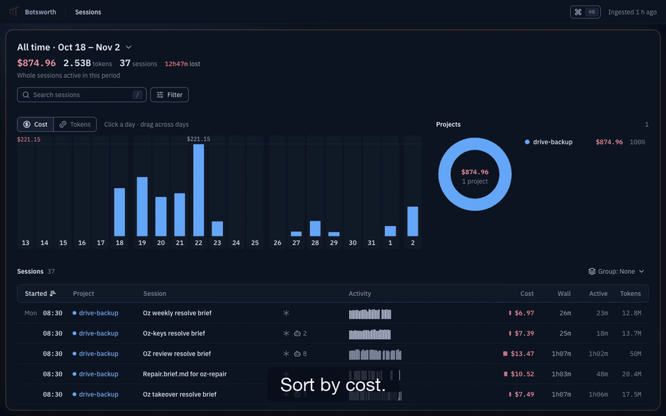

# Botsworth

[](https://github.com/singularityhq/botsworth/actions/workflows/ci.yml)
[](LICENSE)

Botsworth shows where the time, tokens and money of your Claude Code, Codex and omp sessions went. It reads the
session logs those tools already write, keeps the numbers in a local SQLite file, and shows them in a web UI and a
command line. Nothing leaves your machine. See [Privacy](#privacy).


## What it answers

- **Why is the bill so high?** Rank sessions by cost, then split a period by model, project and sub-agent type. In
  the UI: Sessions. In the terminal: `botsworth sessions --sort cost`, `botsworth tasks --by agent_type --measure cost`.
- **Where did a session's wall time go?** The time is split into model working, tools running, sub-agents, waiting
  on you, and stalled. In the UI: Session and Review. In the terminal: `botsworth breakdown <session>`.
- **Which turn or call was the largest?** Each turn opens into its steps. In the UI: Session, then Turn, then
  Detail; press `b` (Biggest) in Session to jump to the costliest turn. In the terminal, `botsworth top` ranks the
  turns or calls of a session by cost (see [From the terminal](#from-the-terminal)), while `botsworth breakdown
  <session>` ranks turns by tokens.
- **Which tools, skills and slash commands cost the most across sessions?** In the terminal:
  `botsworth tasks --by tool --measure cost`.

## Install

You need Python 3.12 or newer and [uv](https://docs.astral.sh/uv/). Building from source also needs Node 24 or
newer and `make`.

From source, which is the only way until the first PyPI release:

```sh
git clone https://github.com/singularityhq/botsworth
cd botsworth
make setup                          # npm ci and UI build, then uv sync
make build                          # builds the UI and the wheel into dist/
uv tool install dist/botsworth-*.whl
```

After the first PyPI release this becomes `uv tool install botsworth`.

## Quick start

```sh
botsworth paths                     # where the store lives; creates nothing
botsworth ingest                    # read your provider logs into the store
botsworth serve --open              # UI and API on http://127.0.0.1:8420
```

Nothing ingests on its own. Run `botsworth ingest` again to pick up new sessions; only logs that changed are read
again. `--provider claude_code` (repeatable; also `codex`, `omp`) reads only some providers. `botsworth ingest
--rebuild` builds a new store from the logs and replaces the old one when it is done; a running `serve` keeps
working. It reads every provider, so it cannot be combined with `--provider`.

If none of the provider folders exist, ingest still succeeds. It prints one JSON object, and each provider in it
reports `"discovered":0` and `"skipped":"root missing"`. `botsworth sessions --table` then shows `total: 0`. Check
the folder names under [Supported providers](#supported-providers).

## Find out why a session cost so much



The pictures below come from one real project, renamed `drive-backup` and scrubbed: 37 sessions over 16 days,
$874.96 in total. Your numbers will differ.

1. **Sessions.** Open the period picker (the default is Last 7 days) and choose "All time". Click the Cost column.
   The header reads $874.96, 2.53B tokens, 37 sessions, 12h47m lost, and the most expensive session ($159.32) is
   at the top.
   
2. **Session.** Open that session. The header shows $159.32 (main thread $21.81, the agents it started $137.51)
   and 21h25m wall: 13h42m running, 7h44m not running, 52m lost. The legend says where the time went: stalled 52m,
   agents 12h58m, nothing running 4h51m, waiting on you 2h01m. The ledger runs in time order, and its "by cost" bars
   mark the expensive turns; press `b` (Biggest) to jump to the costliest one, here turn 31 at $22.65.
   
3. **Review.** Go back to Sessions and open Review for the time across all sessions in the period. Its headline
   reads: "7d02h of session time in 37 sessions. 12h47m was lost to stalls (1 not measured). The largest cause was
   waiting on you (26h21m)." Below it are the findings: stalled, waiting on you, and tests (1,448 test runs, 342 with
   failures). Each has a "Change" suggestion.
   
4. **Turn.** Open the largest turn to see its model calls, tool calls and sub-agent runs in order.
   
5. **Detail.** Open one call to see its tokens, cost and timing. The text of the prompt or output is read from your
   original log file at that moment; the store does not keep it.
   

## From the terminal

Every read command prints JSON by default, so scripts and agents can parse it. Add `--table` for key=value lines
meant for reading, not for parsing. `botsworth --help` lists all 30 commands, and `botsworth <command> --help`
lists the options of one. Global options such as `--db` go before the command: `botsworth --db PATH slow`.

The examples below ran against the demo store. `…` marks rows or text cut for this page. The ids in the output are
the exact arguments for `turn` and `detail`. `breakdown` also accepts a session id shortened to its first 8
characters.

Where did the time of the whole period go? `slow` starts with the review lines:

```sh
botsworth slow --table
```

```text
review: wall 7d 2h, lost 12h 46m, 37 sessions (1 without stall data)
  stalled lost 12h 46m n=10 longest 9h 12m at 2026-10-20T01:39:31+05:30 T2
  you 1d 2h n=48 longest 9h 12m at 2026-10-20T01:39:34+05:30 T2
  tests 13h 45m n=1448 longest 49m 41s at 2026-10-22T21:41:55+05:30 T7
  polling 11h 58m n=573 longest 52m 24s at 2026-10-18T17:03:55+05:30 T9
  message 41m 31s n=1 longest 39m 24s at 2026-10-22T22:44:16+05:30 T12
…
```

The UI shows 12h47m lost for the same period: the UI rounds to the minute, and the CLI's `_h` fields cut seconds
off (46,009,014 ms is 12h 46m 49s).

Where did one session's time go, and which turns used the most tokens? `breakdown` prints a review block, then lists
such as `turns_by_tokens`, which ranks turns by tokens, not cost. This shows that list:

```sh
botsworth breakdown fe22d938 --table -n 3
```

```text
…
turns_by_tokens (3):
  cost_usd=$16.1297 cost_lower_bound=False n_unpriced=0 type=turn turn=claude_code/fe22d938-c9f5-4a89-ad82-53903be8584d/turn/main#9 display_id=T9 kind=human origin=typed label=Q15: A start=2026-10-18T …
  cost_usd=$22.6461 cost_lower_bound=False n_unpriced=0 type=turn turn=claude_code/fe22d938-c9f5-4a89-ad82-53903be8584d/turn/main#36 display_id=T31 kind=human origin=queued label=So? start=2026-10-19T …
  cost_usd=$21.6875 cost_lower_bound=False n_unpriced=0 type=turn turn=claude_code/fe22d938-c9f5-4a89-ad82-53903be8584d/turn/main#32 display_id=T27 kind=human origin=typed label=inspecyt the running s …
…
```

Cost per turn is on each line. The turn with the most tokens was T9 ($16.13); T31 ($22.65) and T27 ($21.69) cost more.
The first lines of the output are the review block (stalled, polling, you, tests), the same causes as in the UI.

Which turn of that session cost the most? `top` ranks by any metric. `--scope` takes the session id exactly as
`sessions` prints it (the `session=` field; `botsworth sessions --sort cost --table -n 1` shows it):

```sh
botsworth top --scope claude_code/fe22d938-c9f5-4a89-ad82-53903be8584d/session/- --kind turn --metric cost_usd -n 3 --table
```

```text
total  cost_usd=$159.3186
claude_code/fe22d938-c9f5-4a89-ad82-53903be8584d/turn/main#36  turn  So?  cost_usd=$22.6461
claude_code/fe22d938-c9f5-4a89-ad82-53903be8584d/turn/main#32  turn  inspecyt the running shells  cost_usd=$21.6875
claude_code/fe22d938-c9f5-4a89-ad82-53903be8584d/turn/main#25  turn  /compact  cost_usd=$20.6256
```

Use `--kind llm_call` for the costliest model calls. Pass a printed id to `botsworth turn <id>` or
`botsworth detail <id>`. `turn` also takes `<session>:T31`, for example
`botsworth turn fe22d938-c9f5-4a89-ad82-53903be8584d:T31`.

Which slash commands cost the most? `/compact` took $129.42 over 12 turns, 15% of the period:

```sh
botsworth tasks --by slash --measure cost --table -n 1
```

```text
tz: Asia/Kolkata
freshness: last_ingest=2026-11-02T10:27:17+05:30 parser_version=2 price_fingerprint=01c11f043ed97afa schema_version=12 api_version=1
by: slash
measure: cost
basis: turn_attr
scope_totals: tok_total=2528668007 cost.cost_usd=$874.9610 cost.cost_lower_bound=False n_unpriced=0 dur_ms_h=7d 2h
unassigned: tok_total=2106892767.0 cost_usd=$736.1616
total_groups: 9
groups (1):
  key=/compact n=12 n_sessions=9 tok_total=403419054.0 cost_usd=$129.4155 cost_lower_bound=False n_unpriced=0 dur_ms_h=11h 56m p50_ms_h=8m 4…
```

Which sub-agents cost the most? `(main)` is the main thread; everything else is sub-agent work. Here `(main)` is
$308.69 of $874.96, so sub-agents carried about 65%:

```sh
botsworth tasks --by agent_type --measure cost --table -n 3
```

```text
tz: Asia/Kolkata
freshness: last_ingest=2026-11-02T10:27:17+05:30 parser_version=2 price_fingerprint=01c11f043ed97afa schema_version=12 api_version=1
by: agent_type
measure: cost
basis: nearest_engagement
scope_totals: tok_total=2528668007 cost.cost_usd=$874.9610 cost.cost_lower_bound=False cost.n_unpriced=0 dur_ms_h=7d 2h
unassigned: tok_total=0.0 cost_usd=$0.0000
total_groups: 231
groups (3):
  key=(main) n=4855 n_sessions=36 tok_total=845777852.0 cost_usd=$308.6890 cost_lower_bound=False n_unpriced=0 dur_ms_h=- p50_ms_h=- p90_ms_h=- share=0.35280319703206414  …
  key=general-purpose n=12 n_sessions=1 tok_total=17435002.0 cost_usd=$66.2646 cost_lower_bound=False n_unpriced=0 dur_ms_h=2h 53m p50_ms_h=13m 39s p90_ms_h=19m 02s share …
  key=s7b-model n=4 n_sessions=1 tok_total=82621750.0 cost_usd=$27.4686 cost_lower_bound=False n_unpriced=0 dur_ms_h=5h 11m p50_ms_h=1m 35s p90_ms_h=3h 39m share=0.031394 …
```

Other keys for `--by` are `tool`, `skill`, `command_key`, `command_class` and `verb`. `--measure` is
`tokens`, `cost`, `time` or `count`.

Other commands that are useful early: `sessions` (a ranked page of sessions), `period` (totals), `turns SESSION` and `turn TURN`
(one session's turns, and one turn's rows), `detail` (one call, tool or message), `source` (the original text) and
`status` (the state of the store and of the last ingest).

### Filters

`sessions`, `period`, `slow` and `tasks` take the same filters: `--from`/`--to` (days) or `--since 7d`, `--tz`,
`--provider`, `--model`, `--branch`, `--project`, `--q` and `--automated`. `breakdown` takes only `--tz` and `-n`;
it works on one session, so it needs no filter. `botsworth <command> --help` shows what each command accepts.

### Custom queries

`botsworth query` runs a query written as JSON, from an argument or from standard input (`-`). This one groups the
cost of every model call by model:

```sh
echo '{"scope":{"all":true},"select":"descendants","where":[{"field":"kind","in":["llm_call"]}],"measure":"own","metrics":["cost_usd"],"group_by":["model"],"limit":3}' | botsworth query - --table
```

```text
total  cost_usd=$874.9610
model=claude-opus-5-5  cost_usd=$482.9494  n=6438
model=claude-sonnet-5-5  cost_usd=$314.6506  n=7467
model=claude-fable-5-1  cost_usd=$74.5851  n=149
```

The default `measure` is `incl` (inclusive): a session's figure includes everything under it. Adding the figures of
a session and its descendants counts the same money several times. Use `"measure":"own"` when you sum across levels.

## How the numbers are counted

- **Cost** is the logged token counts multiplied by a price list. The list is a snapshot of
  [models.dev](https://models.dev) dated 2026-10-12, bundled in the package. It is not what your provider billed you;
  discounts, plans and rounding on the provider's side are not in it.
- **Once per API request.** One request can span several log lines. Cost and tokens are counted once for each
  request, not once for each line.
- **Unpriced models give a lower bound.** If a model has no price in the list, its calls count as unpriced. The cost
  is then shown as a lower bound (`cost_lower_bound` in JSON) together with the number of unpriced calls
  (`n_unpriced`).
- **Inclusive and own.** Inclusive cost of a session or turn contains its sub-agents. Own cost is only what that item
  did itself.
- **Time** is wall time from the first to the last record of a session. Each moment of it falls in the first
  matching category: *model working*; *tools running* (tests and sleeps are marked inside it); *only agents
  running* (sub-agents or background commands); *waiting on you* (a question or permission prompt, or the gap before
  your next message); *waiting for an agent's message*; *usage limit* (inferred); and *nothing running*, which
  includes *stalled* (a finished task waits for an agent that is not running). The parts add up to the wall time.
  Time for Claude Code is taken from log record times, so it is approximate.

The exact rules are in [`docs/specs/interfaces.md`](docs/specs/interfaces.md) and
[`docs/specs/data-model.md`](docs/specs/data-model.md).

## Privacy

- Everything stays on your machine. `serve` listens on `127.0.0.1` unless you pass `--host`.
- Provider log folders are opened read-only. Botsworth never writes to them.
- The store keeps numbers (tokens, cost, times), names, and short previews of at most 160 characters. It does not
  store prompts, model output, thinking, or tool input and output. When you open a detail in the UI or run
  `botsworth source`, the text is read from your original log file at that moment. If you delete or move the log
  file, that text is gone from Botsworth too.
- The only network call in the code is `botsworth.pricing.snapshot.fetch`, which downloads the model price list from
  `https://models.dev/api.json`. It is a maintainer task, run by hand from a checkout with
  `uv run python -m botsworth.pricing.snapshot`. It writes one file, `models.dev-<date>.json`, into
  `src/botsworth/pricing/data/` (add a date tag as an argument to name the file; `--help` shows usage and calls
  nothing). Nothing else ever calls the network: ingest, serve and every query never call it.

## Where data lives

`botsworth paths` prints the exact folder. Defaults, from the platform app-data folder:

| OS | Data folder |
|---|---|
| macOS | `~/Library/Application Support/botsworth/` |
| Linux | `$XDG_DATA_HOME/botsworth/`, else `~/.local/share/botsworth/` |
| Windows | `%LOCALAPPDATA%\botsworth\` |

Windows is not tested yet.

The folder holds `botsworth.sqlite` and SQLite's own `-wal`, `-shm` and `.lock` files, nothing else. Ingest writes no
other files. To use another location, pass `--db PATH` to any command, or set `BOTSWORTH_DB` (the store file) or
`BOTSWORTH_HOME` (the folder). Order: `--db`, then `BOTSWORTH_DB`, then `BOTSWORTH_HOME`, then the default. The store
is a cache over your provider logs: you can delete it and run `botsworth ingest` again. If you delete a provider
log, the sessions it held stay in the store (marked `source_missing`) until the next `botsworth ingest --rebuild`,
which drops them.

## Supported providers

| Provider | `--provider` | Log folder read by default |
|---|---|---|
| Claude Code | `claude_code` | `~/.claude/projects` |
| Codex | `codex` | `~/.codex` |
| omp | `omp` | `~/.omp/agent/sessions` |

## Contributing

See [CONTRIBUTING.md](CONTRIBUTING.md) for how to build, test and send a change, [SECURITY.md](SECURITY.md) for
reporting a vulnerability, and [CHANGELOG.md](CHANGELOG.md) for what changed in each release. `CLAUDE.md` holds the
project map and rules.

## License

MIT. See [LICENSE](LICENSE).

## Why the name?

"Bots' worth" is what your agents were worth. "-worth" is also an English butler's name: someone who keeps the
household accounts and is discreet about them.
